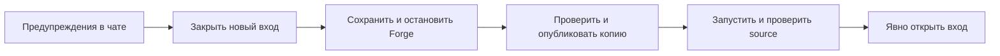

# Один ночной координатор резервных копий

Владелец выбрал **запланированный ночной перезапуск с предупреждением в игровом
чате**. Календарный runner реализован отдельно от ручного цикла и **выключен по
умолчанию**. Ни host job, ни VPS расписание не установлены. Оба способа запуска
используют одну цепочку: предупреждения, закрытие входа, штатная остановка,
проверенная холодная копия, запуск и открытие входа после готовности.

## Одноразовый запуск из systemd.timer

```console
python -m omk admin --config /private/operator.toml nightly run --server dj2 --scheduled
python -m omk admin --config /private/operator.toml nightly status --server dj2
```

Команда выполняется внутри заранее подготовленного Docker controller, а не
запускает игру на host. `systemd.timer` активирует один такой процесс раз в минуту.
Если первое предупреждение дальше минуты, процесс сразу заканчивается; около окна
он выполняет один существующий cycle и заканчивается после complete/skip/error.
Пока service активен, systemd не создаёт второй экземпляр.

Шаблоны — [`omk-nightly@.timer`](../deploy/systemd/omk-nightly@.timer) и
[`omk-nightly@.service`](../deploy/systemd/omk-nightly@.service). Они **не установлены**:
до аудита владельца не создаём controller и не включаем host timer. Docker container
`omk-nightly-<server>` предварительно должен иметь правильные private mounts, bounded
Docker logs и команду выше. `docker start --attach` передаёт его exit status systemd.
Это не разрешение запускать произвольный game container через этот unit.

`Persistent=false`: пропущенный при выключенном host запуск не догоняется.
Минутный UTC trigger не дублирует настройку ежедневного времени/timezone/warnings —
они остаются в существующей validated policy внутри coordinator. Это поддерживает
warning offsets не кратные минуте и сохраняет прежние правила DST/даты.

Без явного `OMK_NIGHTLY_SCHEDULE_ENABLED=true` команда возвращает `disabled` без
создания календарного журнала и без Docker calls. Старый `watch` оставлен как
deprecated alias **одноразового** запуска, постоянного watcher больше нет.
Владелец ещё не выбрал рабочее время; 05:00 остаётся default.
Простой/disabled/busy не печатает полный status в stderr каждую минуту. Unit
отбрасывает штатный stdout, сохраняет stderr реальных переходов/ошибок в journal;
ограничения host journal проверяем при развороте VPS.

В приватном `.omk-admin/nightly-schedule/dj2.json` хранится одна ограниченная
запись: будущее окно, прежний результат и fence уже попытанной даты. Она не
содержит пароль или игровой токен. Сначала резервируется дата/ID, затем
создаётся существующий nightly cycle с четырьмя заранее выбранными child IDs.
Общий owner lock исключает двойное действие двух процессов; во время ожидания
он освобождается. Потеря процесса после записи root до подтверждения в календаре
подхватывает только точно соответствующий root, не создаёт новую операцию.

После остановки процесса на часы пропущенное окно **пропускается**, а не
догоняется посреди дня. До первого предупреждения допустима только
`OMK_NIGHTLY_WARNING_GRACE_SECONDS`. Предварительные проверки могут сдвинуть
фактический restart позже nominal времени: полный отсчёт игрокам не сокращается.
DST gap пропускается; fold использует только первое вхождение. Уже попытанная
локальная дата и UTC-момент сохраняются: откат часов и смена timezone не дают
второй запуск за тот же защищённый день. Поведение привязано к часам ОС, не к
независимому источнику времени.

Нормальная ошибка завершает одноразовый запуск с ненулевым результатом. При ошибке
preflight без cycle root день считается пропущенным; повторный запуск ждёт
следующее подходящее окно. При существующем незавершённом root runner оставляет
`failed` и не повторяет опасный шаг вслепую. Для восстановления используются
уже знакомые `nightly status/run/cancel --operation <id>`. После подтверждённого
complete/cancel runner сможет назначить следующий день. Отмена календарного
цикла до stop не открывает уже закрытый вход. `Ctrl+C`/остановка runner также
не являются отменой и не меняют состояние игры сами по себе.

Снятие enabled-флага при следующем запуске приостанавливает выполнение; оно
не удаляет durable state и не отменяет уже начатое обслуживание. Env работающего
процесса сам не перечитывает файл: изменение применяется после его перезапуска.
Изменения политики для ещё будущего окна перепланируют его, а для начатого
цикла требуют восстановления с прежней frozen policy.

`status --server` только читает календарь. `armed` означает сохранённое будущее
окно, **не подтверждение работающего timer/service** (`scheduler_running_verified=false`).
Смена результата печатается в stderr JSON; polling занятого lock не спамит лог.
Вывод процесса на host пока не подключён к постоянному хранилищу/мониторингу.

До отсчёта резервируется место под один
nightly, один maintenance, один backup и **два** ingress journals. При default
лимите 128 без архивации ingress исчерпается примерно после 64 ночей, раньше — при ручных
операциях. Для полугода ежедневных циклов ориентир —
`OMK_MAINTENANCE_JOURNAL_COUNT=512` и `OMK_BACKUP_JOURNAL_COUNT=512`, с запасом
на остальные действия и проверкой общего диска. Это конечный предел, не retention.
Теперь можно отдельно включить ограниченную архивацию завершённых циклов ниже.
При нехватке слотов новый цикл отказывает **до** предупреждений. Не чистить JSON вручную.

## Ограниченная история завершённых циклов

`OMK_JOURNAL_ARCHIVE_ENABLED=true` разрешает перенос старых **complete** nightly
вместе с их четырьмя завершёнными child journals. Новых CLI-команд нет: ручной
`nightly run --server` и календарный runner вызывают один Python service до
проверки свободных slots и до предупреждений. По умолчанию выключено, host job
не устанавливается. Последние семь завершённых циклов каждого сервера остаются
в рабочих папках. Active/cancelled/failed, отдельные ручные maintenance/backup/
ingress и журналы reset/restore/cutover этот механизм не переносит.

Архив лежит **рядом с `operator.toml`**, в приватной папке
`.omk-admin/journal-history/{nightly,maintenance,backups,ingress}/<id>.omkj`.
Это история действий владельца, а не резервная копия мира. Один `.omkj` содержит
строку JSON с identity/SHA-256 и точные исходные JSON-байты записи; вручную его
не редактировать. На Linux новые файлы имеют mode 600, папки — 700. Ссылки и
многократно привязанные файлы не допускаются. Старые ID продолжают читаться через
прежние `nightly/maintenance/backups/ingress status`; родственные записи и
calendar ACK находятся и после переноса. Повторно использовать ID или выполнить
архивное действие нельзя. Выключение env-флага не мешает читать старую историю.

Под общим owner lock проверяются пять записей, их server/identity/frozen scope
и связи. Сначала все архивные файлы записываются атомарно и синхронизируются,
затем повторно проверяются хеши/точные байты. Только после этого удаляются
рабочие дубликаты, root — последним. Прерванный перенос продолжается по тем же
ID; незавершённые временные копии этого подтверждённого scope можно пересоздать.
Конфликт живой/архивной записи, повреждённая квитанция, неизвестный файл и ошибка
диска дают отказ, а не молчаливый выбор одной версии. Чтение child проверяет
связь с завершённым root. Это не доказательство стойкости к потере питания host.

| Переменная | Default | Ограничение |
| --- | --- | --- |
| `OMK_JOURNAL_ARCHIVE_ENABLED` | `false` | Только `true`/`false` |
| `OMK_JOURNAL_ARCHIVE_KEEP_CYCLES` | `7` | 1–100 завершённых циклов на сервер в рабочих папках |
| `OMK_JOURNAL_ARCHIVE_BATCH_CYCLES` | `32` | 1–100 групп за один preflight |
| `OMK_JOURNAL_ARCHIVE_MAX_FILES` | `10000` | 5–20000 файлов в общей истории всех серверов |
| `OMK_JOURNAL_ARCHIVE_MAX_BYTES` | `268435456` | 1–2147483648 логических байт, default 256 MiB |

Один цикл занимает пять файлов: file cap по умолчанию вмещает 2000 циклов
(около 5,5 лет при одном сервере ежедневно), **если раньше не достигнут byte cap**.
Это конечный бюджет. Allocation/директории добавляют накладные расходы; число
файлов тоже ограничено, перед записью сохраняется свободный project reserve из
storage policy на файловой системе истории. История не вытесняет старые записи:
на них могут ссылаться recovery-планы. При заполнении новый перенос/цикл
отказывает до предупреждений, существующие записи сохраняются. Увеличение квоты
требует проверки диска. Не удалять историю ради освобождения slots.

Папку `.omk-admin` нужно включать в защищённую копию operator state и при миграции
переносить целиком, включая календарь и `journal-history`. Одного world ZIP для
этого недостаточно. Off-host, перенос с ротацией истории и общий production
recovery ещё остаются #33; автоматического удаления старой истории нет.

Maintenance plan TTL обязан быть больше первого интервала предупреждения плюс
grace. Конфигурация, не удовлетворяющая этому условию, отказывает до действий.
Внешние jobs/доступ к Docker этим сервисом не исключаются; owner-процесс с Docker
socket имеет административные полномочия, а не изоляцию от host.

Приёмка: полная DJ2 2.23.4/Core 0.3.6 в Linux Docker, 22 native и 41 independent
условие. Сам owner controller тоже исполняется в Linux-контейнерах. Реальный
выход Python с кодом 73 после fsynced root до ACK, два параллельных watcher,
один архив/цикл, предупреждение каждому из двух Drasl-аккаунтов один раз.
Оба аккаунта повторно вошли, вещи/XP сохранены; CRC/SHA/полнота manifest
проверены по экспорту. После complete оба watcher завершены SIGKILL (137,
не OOM), новый процесс сохранил будущее окно без второго цикла сегодня.
Исходный container и frozen code прежние, новый Core boot проверен до open.
Game clean exit без crash/OOM; свои scopes удалены после экспорта.

Ранний fixture с неверным interpreter и отдельное зависание WSL до календаря
не выданы за успех: после разрешённого владельцем restart выполнен свежий проход.
Первый offline verifier включил file manifest в glob metadata; выбор исправлен
по точным watcher IDs, исходный native report не менялся. Это protocol actors,
не графический клиент и не потеря питания host посреди обслуживания.
[Протокол](validation/nightly-calendar-2026-11-12.json).

## Один явный цикл и продолжение после прерывания

```console
uv run python -m omk admin --config .omk-admin/operator.toml nightly run --server dj2
uv run python -m omk admin --config .omk-admin/operator.toml nightly status --operation <operation-id>
uv run python -m omk admin --config .omk-admin/operator.toml nightly run --operation <operation-id>
uv run python -m omk admin --config .omk-admin/operator.toml nightly cancel --operation <operation-id>
```

Первый вызов начинает отсчёт **сейчас**, с первого интервала
`OMK_NIGHTLY_WARNINGS_SECONDS`; `LOCAL_TIME`/`TIMEZONE` использует scheduled coordinator.
Для календарного запуска применяется `run --scheduled`, без cron поверх ручного `run`.
Номер операции печатается перед отсчётом; `status` ничего не выполняет.
Отдельных transport-команд для предупреждений учить не нужно: CLI и будущая
TUI используют общий Python service.

Требуются настроенные owned source/store/HAProxy, приватные allowlists
`operator.toml`, `backups.toml`, `maintenance.toml`, `nightly.toml` и
`storage.toml` с постоянным auth volume. Source должен уже работать, вход —
быть открыт владельцем. Заведомо закрытый сервер цикл сам не открывает.
Оба stock FTB triggers должны быть отключены **на диске и в загруженной Java**;
текущая копия stock-мода не должна выполняться. Config не переписывается.

Приватный журнал `.omk-admin/nightly/<operation-id>.json` связывает заранее
выбранные identities четырёх существующих операций: maintenance, backup,
закрытие и открытие ingress. Пароля RCON/Drasl в нём нет. Каждый шаг использует
общий owner lock; ожидание между предупреждениями освобождает его. Другой
процесс может прочитать status или отменить ещё не начатую остановку.
Число журналов ограничено `OMK_MAINTENANCE_JOURNAL_COUNT`; автоматически их не
удаляем, чтобы не потерять сведения для восстановления.

После Ctrl+C/потери ответа используется **тот же** `--operation`. Дочернее
намерение записывается до действия; подтверждение уже отправленных stop/start/
изменений ingress не отправляет их повторно. Незавершённая публикация сверяется
с retained staging/receipt существующего backup service. Если подготовленная
копия ещё не имеет пригодного доказательства, цикл отказывает и сохраняет
сервер остановленным, вход закрытым и файлы для разбора. Прямой `docker start`
не является восстановлением и обходит эти проверки.

Перед закрытием входа и записью повторно проверяется общий
[storage estate](PROJECT_STORAGE.md), совместимость caps и место под staging.
Резерв новой копии равен **максимуму** project reserve и backup reserve.
Это консервативный допуск по наблюдению, а не файловая квота или защита от
внешней программы, которая одновременно заполняет диск.

`OMK_NIGHTLY_WARNING_GRACE_SECONDS` по умолчанию `30`, допустимо `1–60`.
Просроченный отсчёт не запускает новую остановку спустя часы после предупреждения.
До попытки stop можно отменить цикл и начать новый. `cancel` отменяет только
намерения и **не открывает вход**: если close уже был выполнен, владелец после
проверки открывает его существующей ingress-операцией. После stop intent
отмена отказывает; нужно разбирать/продолжать существующие дочерние операции.

Смена runtime **до запуска Java**, container/volume/proxy identity, boot,
политики или неподходящий reset/cutover блокирует продолжение. Полный digest
сверяется перед stop и start существующим maintenance service. После загрузки
Forge часть properties/служебных config и кешей может штатно измениться:
в этой фазе сохраняются точные проверки FTB JAR/config и loaded policy, а не
требование побайтного равенства всего дерева до/после boot. Это не контроль
против постороннего процесса с правом записи в server volume.
Открытие происходит только после готовности
того же source, точной завершённой копии и нового Core boot с disabled/idle FTB.
Обновление сборки и вайп мира в этот цикл не входят. Успех цикла также не означает
общей готовности проекта к игрокам: `ready_for_players=false` сохранён.

Приёмка на DJ2 2.23.4/Core 0.3.6 в Linux Docker: два Drasl-аккаунта,
два старта одного source, пять потерянных подтверждений после настоящих
close/stop/publish/start/open и ровно одна подготовка/публикация. Оба аккаунта
повторно вошли; изумруды/алмазы и опыт проверены в сохранённых NBT и копии.
26 native и 32 независимых условия, CRC/SHA/полнота archive manifest, clean
stop без crash/OOM. Собственные scopes удалены после экспорта.

Три подтверждённых изменения при boot: `server.properties`,
`config/astralsorcery/amulet_enchantments.cfg`, `config/teamreborn/configData.nbt`.
FTB config и owned JAR прежние. Первичный отказ до open сохранён отдельно,
исходный report не исправлялся. Потеря подтверждения имитировалась прерыванием
Python после реального действия; это не отдельный тест физической потери
питания или SIGKILL всего host. Игроки — protocol actors, не графический клиент.
[Протокол](validation/nightly-cycle-2026-11-12.json).

Отдельный follow-up после CI: inspection существующего store на readonly Linux
mount сначала воспроизвёл отказ r+b-lock. Теперь rb/shared flock сохраняет
исключение publisher без права записи; Windows locking прежний. 13 Docker
cold-backup условий и readonly чтение экспортированной DJ2-копии пройдены,
четыре файла store неизменны. Это отдельная filesystem-проверка после native
прохода, а не ещё два старта Minecraft.

## Предварительная проверка владельца

```console
uv run python -m omk admin --config .omk-admin/operator.toml nightly preview
uv run python -m omk admin --config .omk-admin/operator.toml nightly inspect --server dj2
```

`preview` не обращается к Docker и не требует `nightly.toml`. Он показывает
ближайшее окно, для которого ещё можно отправить **все** предупреждения. Если
время первого предупреждения уже прошло, выбирается следующий день: запуск
утилиты после простоя не должен немедленно отключить игроков. Это расчёт, не
зарегистрированное задание; повторный вызов не отправляет сообщений.

| Переменная | Default для preview | Допустимое значение |
| --- | --- | --- |
| `OMK_NIGHTLY_LOCAL_TIME` | `05:00` | Строго `HH:MM`, 00:00–23:59 |
| `OMK_NIGHTLY_TIMEZONE` | `Europe/Moscow` | Именованная IANA timezone, например `Europe/Warsaw` или `UTC` |
| `OMK_NIGHTLY_WARNINGS_SECONDS` | `600,300,60,10` | 1–8 уникальных убывающих значений 1–3600, без пробелов |
| `OMK_NIGHTLY_SCHEDULE_ENABLED` | `false` | Только `true`/`false`; разрешает scheduled activation, не устанавливает job |

05:00 — предлагаемый default, владелец конкретное время ещё не выбирал.
Часовой пояс задаётся явно и не наследуется от VPS/Windows. При переводе часов
несуществующее локальное время пропускается, повторяющееся используется только
в первый раз. Предупреждения считаются в реальных секундах от UTC-момента
рестарта; JSON содержит UTC и локальное время с offset. Сам `preview` не
резервирует дату; durable journal создаётся только включённым scheduled runner.

`inspect` дополнительно требует приватный `.omk-admin/nightly.toml` (Linux mode
600), существующие `backups.toml`/`maintenance.toml` и настроенный maintenance
binding. [Пример allowlist](../deploy/nightly.example.toml):

```toml
schema = 1
[servers.dj2]
adapter = "ftb-backups-1.1.0.1-disabled-v1"
```

Проверяется именно закреплённый ниже FTB JAR и канонический Forge config с
`B:enabled=false` **и** `B:force_on_shutdown=false`. Отсутствующие, повторные,
неизвестные/неподдерживаемые свойства, другой SHA и изменение runtime дают
отказ. Config автоматически не переписывается. Любые правки FTB готовятся в
остановленной изолированной копии, до замораживания maintenance/runtime плана.

Linux helper читает source volume без записи, без сети/caps/Docker socket;
образы и ресурсные пределы наследуются от проверенного maintenance worker.
Проверяются container/volume/config identities до и после, общий owner lock
исключает параллельную собственную операцию. Содержимое properties/config,
пароли и список файлов в ответ не попадают. CLI может создать только свой
lock и ограниченный audit рядом с operator config.

Успех означает **проверенную конфигурацию на диске**. Изменение файла работающей
Java не доказывает применение его значений в памяти. Поэтому ответ всегда
сохраняет `live_config_verified=false`, `other_writers_verified=false` и
`activation_approved=false`. Внешние cron/systemd jobs, ручные OP-команды FTB
и сторонний Docker CLI этим наблюдением не исключаются. Нет ни разрешения на
автоматический restart, ни проверки общего дискового бюджета; последний
смотрится отдельно через `storage estate` и повторно перед фактической записью.

## Внутренняя связь с работающим сервером

Core 0.3.6 предоставляет ограниченный owner bridge; Python использует
`MaintenanceConsole` в существующем `omk/maintenance_console.py`. Новых действий
CLI он не добавляет. Этот интерфейс нужен будущему координатору и может
использоваться будущей TUI. Саму Rust TUI на этапе запуска DJ2 не разрабатываем.

Вызов `probe()` возвращает значения **из памяти Java**: идентификатор boot,
адаптер резервных копий, выключены ли automatic/shutdown triggers и не выполняет
ли stock-мод копию сейчас. Для FTB 1.1.0.1 отдельная optional integration проверяет
версию и SHA загруженного JAR, затем читает его реальные поля. Без поддержанного
provider Core остаётся общим: nightly readiness и предупреждение отказывают.
Проверка на диске через `nightly inspect` сохраняет прежний disk-only контракт;
рабочий цикл должен сверять обе стороны, а не заменять одну другой.

`warn(boot, operation, seconds_before)` передаёт только идентификаторы и число
секунд 1–3600. Произвольного текста или RCON-выполнения в этом API нет. Текст
фиксирован:

> [OmkalityCraft] Плановый перезапуск через 60 с. Сервер сохранит прогресс и
> создаст резервную копию. Возвращайтесь через несколько минут.

Чтение состояния и рассылка выполняются в основном потоке Minecraft. Старая
boot identity после restart не принимается. Отменённая до начала задача не
исполнится позже при разгрузке очереди. Источник обращения должен быть RCON;
игроку, включая OP, скрытый transport не даёт выполнять эти действия.

Повтор одной пары operation/countdown в том же boot возвращает исходный
receipt, без новой рассылки. До отправки сохраняется fence попытки; частичная
ошибка не превращается в безопасный retry и не получает success. Кеш имеет
лимит 256 попыток за boot и не вытесняет старые fences: переполнение отказывает.
Новый boot начинает новый кеш, но требует уже новую boot identity. Это не
гарантия прочтения сообщения человеком; отключившийся клиент может его не увидеть.

Предупреждение само не останавливает игру, не меняет FTB config, не создаёт
копию, не открывает вход и не включает scheduler. Во время выполнения оно
требует disabled/idle backup provider; отдельный запуск ночной операции всё ещё
должен иметь durable журнал и guards уже принятых maintenance/backups/ingress.

Игровая приёмка bridge: два старта одной DJ2 2.23.4 в Linux Docker, два настоящих
Drasl-аккаунта и protocol actors (не графический Minecraft). Подтверждены loaded
flags, оба полученных chat packets, отсутствие второй рассылки после retry и
реальной потери RCON-ответа, отказ старого boot и OP-игрока. 14 игровых условий,
два условия экспортов и 32 независимых проверки. Первичный candidate отказал
из-за JAR URL handling; после red/green исправления выполнен свежий игровой
проход. Ошибочные допущения postprocess об имени Core JAR и пустом ops.json
исправлены offline по сохранённому экспорту; известный Forge fake profile
отделён от игроков. Исходный report сохранён. Новые объявления CLI отсутствуют,
nightly coordinator не включён. [Протокол](validation/maintenance-bridge-2026-11-12.json).

## Почему не оставляем штатную ротацию FTB как окончательное решение

В текущем DJ2 установлен `FTBBackups-1.1.0.1.jar`, SHA-256
`6b6bcbbf6ac4528657345e1696339528a44643ecb06e6137908eafb8432bd962`.
Зафиксированные [исходники Backups.java](https://github.com/FTBTeam/FTB-Backups/blob/4e77b0390fb1f347eac3e6f341233ec8bedd035e/src/main/java/com/feed_the_beast/mods/ftbbackups/Backups.java)
показывают удаление старых копий до открытия нового ZIP. В source виден и другой
предел: отдельные ошибки копирования перехватываются внутри цикла, поэтому
отметка success сама по себе не подтверждает полноту архива. Второй случай здесь
не проверялся отдельной игровой инъекцией.

`backups_to_keep=0` отменяет count-based ограничение, но не size/free-space loop.
В [FTBBackupsConfig.java](https://github.com/FTBTeam/FTB-Backups/blob/4e77b0390fb1f347eac3e6f341233ec8bedd035e/src/main/java/com/feed_the_beast/mods/ftbbackups/FTBBackupsConfig.java)
ноль размера не означает безопасное отключение ротации; percent относится к
полной ёмкости filesystem. Менять числа в конфиге недостаточно, чтобы получить
гарантию сохранения последней хорошей копии при отказе новой записи.

### Что проверено на настоящей DJ2

Опыт использует новый Linux Docker volume с полной DJ2 2.23.4, прежние Core/Fix
и **неизменённый** stock FTB JAR. Две исходные ZIP-копии взяты из ранее принятых
холодных архивов и проверены по CRC. Для испытания задана заведомо малая квота,
count limit отключён, таймер перенесён далеко за время опыта. В пути для новой
ZIP-копии заранее создан каталог: это воспроизводимый отказ записи, **не реальный
ENOSPC** и не повреждение диска.

В принятом retention-опыте сначала выполнен `save-all flush` и подтверждено
наличие `level.dat`. Пройдено 13 native и 20 независимых условий.

FTB удаляет оба прежних архива ради квоты, затем новая ZIP-запись отказывает.
Отсутствие старых файлов подтверждено отдельно. Игра продолжает работать.
Следующая контрольная копия тем же модом создаётся, её ZIP/CRC и запись success
проверяются после чистой остановки. Это подтверждает конкретный риск ротации,
а не утверждение, что каждый штатный FTB backup повреждён.

Один ранний опыт исключён из принятой приёмки: стенд ожидал в логе `/srv/backups`,
тогда как штатный мод пишет `/srv/./backups`. Контрольная копия фактически была
создана; сервер завершился без crash/OOM. Данные экспортированы, собственные
scopes очищены; matcher исправлен. Итоговая приёмка повторена на свежем стенде.
[Обезличенный протокол](validation/ftb-retention-2026-11-12.json).

Отдельно сохранено наблюдение на совершенно новом мире до явного первого save:
FTB сообщил success и выдал ZIP с корректным CRC, но без корневого `level.dat`.
После штатной остановки файл присутствует в сохранённом мире. Это не считается
положительным контролем полноты и не скрывается как ошибка matcher. Для итогового
retention-опыта введено явное предусловие: `save-all flush` и проверенный
`level.dat` до начала. На рабочие миры это наблюдение автоматически не переносится.

## Выбранное направление

Для первого запуска планируется один управляемый ночной цикл на основе уже
проверенных [maintenance](OWNER_MAINTENANCE.md), [cold backups](COLD_BACKUPS.md) и
[закрытого входа](OWNER_INGRESS.md). Его включение требует отдельной приёмки:



1. Явная проверка, что штатный periodic/shutdown writer FTB отключён и другой
   ночной job не работает. Факт `enabled=false` не является доказательством
   отсутствия посторонних скриптов. Никакого второго расписания поверх FTB.
2. Настраиваемые время, timezone и интервалы предупреждения в чате. До закрытия
   входа игроки получают понятный countdown; повтор/перезапуск самого job не
   должен спамить или выполнять stop/start заново.
3. Проверка [общего бюджета](PROJECT_STORAGE.md) и резерва, закрытие входа,
   штатное сохранение/остановка и создание одной проверенной cold-копии.
   Новая копия публикуется **до** ротации; последняя пригодная не удаляется ради
   неудачной попытки. Неизвестные pending/retired данные не чистятся автоматически.
4. Проверка обеих сторон сбоя: потеря ответа и прерывание процесса, отказ диска,
   неуспешный stop/start, параллельный maintenance. Открытие только после
   подтверждённой готовности того же source. Автоматический возврат после
   неудачного backup требует отдельного доказательства; текущий start не следует
   обходить прямой Docker-командой.

Drasl state и приватные operator configs должны входить в общий план защиты,
но world backup не является резервной копией аккаунтов. Для auth сохраняется
[свой согласованный snapshot/restore](AUTH_STORAGE.md). Encrypted off-host copy
и её проверенный возврат также остаются открытым этапом. Один именованный volume
не защищает от потери диска VPS.

## Проверенная область preflight — 12 ноября 2026

Полная DJ2 2.23.4/Linux Docker, два старта того же container, 12 native и
25 independent условий. При enabled=true stock FTB создал положительную копию
с level.dat/CRC, а настоящая owner CLI отказала. После выключения enabled и
force_on_shutdown на остановленном стенде preflight принят для stopped/running
source. Каждый из 1809 экспортированных runtime/backup файлов до/после inspect
сохранён побайтно. Source/helper код не менялся во время испытания.

Во втором boot проверены ручной console trigger, не менее 195 секунд наблюдения
через полный timer 0.05 часа (180 секунд) с выключенным online-gate и clean stop:
новой stock-копии или записи receipt нет. Это ограниченный опыт выбранной версии,
не доказательство отсутствия чужого cron/job или возможности privileged OP-команды.
Game crash/OOM нет; свои scopes убраны после экспорта. Windows: 1742 unit +55 UI,
48 skipped; Linux Docker focused: 280, включая четыре новых Linux-only link cases.
67 новых cases включают календарь/DST, malformed config, changed artifact/runtime/
identity и readonly helper sandbox. [Протокол](validation/nightly-preflight-2026-11-12.json).

Это подготовленное решение и критерии следующего шага. Исходные игровые данные,
FTB config рабочего сервера, VPS и публичный доступ этим этапом не менялись.

## Приёмка одноразового host trigger — 13 ноября 2026

Focused Windows/Linux Docker: 158 условий для monitoring config и существующих
nightly policy/cycle/schedule/CLI. Future/disabled/busy возвращаются без ожидания
следующего дня и без повтора уведомлений; early activation, одна дата/один cycle,
отказ operation+scheduled. Самостоятельный Docker process: disabled завершился 0,
невалидный enabled — 1; `docker start --attach` вернул те же коды. Это не живая
systemd-инсталляция и не новый native restart игры: существующая игровая chain
не переписывалась. Полный production lifecycle/storage budget остаётся #33/#38.
