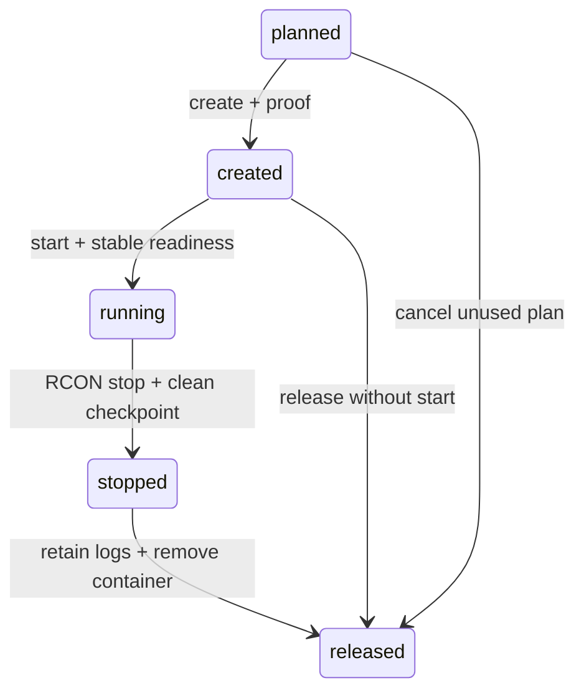

# Проверочный запуск подготовленной копии

`omk admin resource-resets slot-*` управляет отдельным Docker-контейнером вокруг
проверенного `runtime-ready` кандидата. Это утилита владельца: игровой и RCON-порты
публикуются только на `127.0.0.1`. Исходный сервер остаётся остановленным.
Публичный адрес, proxy и профиль лаунчера команды не переключают.

## Подготовка

Сначала выполните [maintenance, backup, data stage и runtime seal](OWNER_RESOURCE_STAGING.md).
Сохраните ID ресурсной операции `R`. Нужны подготовленный sealed target volume,
остановленный исходник и его завершённый проверенный backup. Target был пустым
перед data stage; на этапе slot он уже содержит проверенные world/runtime. После создания
контейнера только его полный immutable ID разрешается как ссылка на target;
чужой контейнер или helper блокирует дальнейшие действия.

Скопируйте [`deploy/candidate-slots.example.toml`](../deploy/candidate-slots.example.toml)
в `.omk-admin/candidate-slots.toml`, задайте приватные права `600` на Unix.
Настройте уникальное имя контейнера, существующий owned bridge и его label,
раздельные loopback-порты, внутренние порты из текущего `server.properties`,
внутренний URL Drasl и путь к его **публичным** authlib metadata. JSON metadata
содержит только `meta`, `skinDomains`, `signaturePublickey`; management/session
ответы вместо него не принимаются. Пароль RCON читается из существующего
приватного operator credential-файла и не передаётся в аргументах Java.

Изменять исходный `server.properties` ради совпадения портов после подготовки
нельзя: это нарушит frozen fingerprint. Если конфигурация должна измениться,
нужно завершить текущую операцию и подготовить новый план с проверенной копией.

Шаблон [Forge 1.12.2](../profiles/runtime/forge112-server.json) задаёт main class,
проверенные Forge/authlib JAR и их SHA. Используется прежний pinned Java image.
Произвольные JVM-флаги, shell entrypoint, скопированные Docker Inspect Env/Args
и загрузка зависимостей по сети этим интерфейсом не предусмотрены. Публичные
metadata, шаблон, logging profile, image, bridge и команда фиксируются в плане.
Перед первым стартом helper повторно сверяет все байты world/runtime и ports.
Helper работает read-only, без сети и Docker socket.

## Команды

`R` — ID подготовленного ресурсного сброса; `S` — новый ID из `slot-plan`.

```console
uv run omk admin --config .omk-admin/operator.toml resource-resets slot-plan --operation R
uv run omk admin --config .omk-admin/operator.toml resource-resets slot-create --operation S
uv run omk admin --config .omk-admin/operator.toml resource-resets slot-start --operation S
uv run omk admin --config .omk-admin/operator.toml resource-resets slot-status --operation S
uv run omk admin --config .omk-admin/operator.toml resource-resets slot-stop --operation S
uv run omk admin --config .omk-admin/operator.toml resource-resets slot-release --operation S
```



Каждая внешняя команда сначала сохраняет durable intent. Если CLI оборвался
или ответ Docker потерян, посмотрите `slot-status`, затем выполните:

```console
uv run omk admin --config .omk-admin/operator.toml resource-resets slot-reconcile --operation S
```

`reconcile` подтверждает уже состоявшийся create/start/stop/remove, без повторной
отправки lifecycle-команды. Неоднозначное состояние остаётся заблокированным
для расследования владельцем: например, create intent без найденного контейнера
не считается успешной отменой. Ошибка Docker daemon не считается отсутствием.

`start` допускается один раз из `created`; после `stopped` повторный старт этой
операции не поддерживается. Проверяются immutable ID/image/volume/bridge,
loopback bindings, лимиты и sandbox. Готовность требует текущего boot `Done`,
ответа Core и стабильного окна. Неожиданный restart, fatal log, OOM или нечистая
остановка не подтверждаются. Автоматического force kill/remove нет.

`slot-status` читает сохранённую сводку. `health_confirmed=true` означает успешно
завершённую проверку при переходе в `running`, а не непрерывный мониторинг.
`promoted=false` и `ready_for_players=false` сохраняются на всех этапах.

`release` удаляет только никогда не запущенный либо подтверждённо чисто
остановленный контейнер. Target volume сохраняется. До удаления удерживается
ограниченная приватная копия последних строк Docker log с SHA; при потере ответа
после удаления сверяются журнал, файл и отсутствие контейнера. Даже уже удалённый
контейнер не снимает блокировку родителя, пока intent не подтверждён.

Для возврата исходника после испытания:

```console
uv run omk admin --config .omk-admin/operator.toml resource-resets abandon --operation R
uv run omk admin --config .omk-admin/operator.toml maintenance start --operation M --backup-operation B
```

`M` и `B` — исходное maintenance window и его backup. Пока slot не `released`,
`abandon` запрещён; пока родитель не `abandoned`, исходник не стартует и окно
нельзя отменить. Этот путь возвращает прежний сервер, а не продвигает кандидата.

## Ресурсы и хранение

Значения читаются из окружения с безопасными defaults и проверкой диапазона.
На `create` они должны совпадать с планом; дальнейший цикл использует frozen policy.

| Переменная | По умолчанию | Диапазон |
| --- | ---: | ---: |
| `OMK_SLOT_MEMORY_MIB` | 8192 | 1024–65536 |
| `OMK_SLOT_HEAP_MIB` | 6144 | 512–49152 |
| `OMK_SLOT_INITIAL_HEAP_MIB` | 1024 | 256–49152 |
| `OMK_SLOT_CPUS` | 4 | 1–32 |
| `OMK_SLOT_PIDS` | 512 | 128–4096 |
| `OMK_SLOT_LOG_BYTES` | 4194304 | 65536–8388608 |

Initial heap ≤ max heap ≤ container memory − 512 MiB. Дополнительно действуют
[maintenance TTL/timeout/stable-window/journal limits](OWNER_MAINTENANCE.md).
Контейнер имеет read-only rootfs, единственный RW mount target в `/srv`, drop ALL
capabilities, no-new-privileges, отключённые restart/core dumps и локальную
Docker-ротацию 3×10 MB. Это не лимит файлового логирования/миров внутри volume:
для них сохраняется отдельная [политика хранения](WORLDS_AND_STORAGE.md).

Приватные журналы: `.omk-admin/candidate-slots/S.json`, до 64 KiB каждый;
сохранённый Docker log: `.omk-admin/candidate-slots/S.log`. Число операций
ограничено общим journal limit, автоматического удаления истории нет. Архивируйте
только завершённые операции вне активной папки; source/backup/target credentials
и эти файлы не публикуются. Новый periodic backup writer не добавлен.

## Границы

Проверка `Done`/Core не заменяет игровые acceptance-тесты. Сохранённый pinned
PlaneFix может создавать известный fake OP `[Minecraft]` при загрузке —
[его отдельная политика описана здесь](SPAWN_AND_GRAVES.md). Этот шаг не выдаёт
игрокам OP и не меняет PlaneFix/FTB permissions ради прохождения проверки.

Публичное переключение адреса и восстановление после неудачного cutover,
online-эвакуация/закрытие переходов, остальные serializers/transport adapters,
wipe произвольных измерений и GUI-проверка здесь не реализованы. Текущий путь
ограничен отдельно подготовленным ресурсным миром DJ2; профили других сборок
не объявляются проверенными.

## Приёмка — 11 ноября 2026

Полная DJ2 2.23.4 / Core 0.3.5 / DJ2Fix 0.1.4, Linux Docker: **42 native и
130 независимых условий**. Два Drasl-аккаунта, один cold backup, два старта
исходника и один старт кандидата именно через owner controller. Для каждого
create/start/stop/remove намеренно терялся ответ; `reconcile` подтверждал факт
без второй команды. Оба аккаунта вошли в копию, `/resource` создал новый ресурс;
штатная остановка и release сохранили его том и приватный ограниченный log.
Только после подтверждения release и явного abandon исходник вернулся.

Все 320 исходных world-файлов неизменны во время подготовки и trial. До первого
старта в копии 302 world-файла; 2015 runtime-файлов / 480187632 байта побайтно
совпадают с источником. Сохранены typed Inventory/XP/UUID, другие homes/claims;
ресурсный home не возвращается. Проверены CRC/SHA и все файлы фактического backup.
Собственные game/auth/store/target scopes удалены только после экспорта.

55 новых synthetic случаев: штатный цикл, четыре потерянных ответа, изменение
image/command/Env/ports/mount/sandbox/bridge/labels, OOM/nonzero exit, конфиги,
pins/properties, подмена retained log и недопустимые переходы до create.
Windows: 1579 unit/UI / 16 skipped; Linux focused: 385, read-only source,
network none, 2 CPU / 1 GiB. Моки lifecycle в этих тестах отдельно от native игры.
Два последних red/green теста исправляют только отказ неверного перехода до
чтения ещё отсутствующего container snapshot; успешный native путь не изменён.

Один ранний прогон исключён: приватный exporter ошибочно запрещал ссылку на
чисто остановленный собственный контейнер. Minecraft не падал; исходник сверили,
выполнили public release и экспортировали данные до scoped cleanup. Условие
публичного controller не ослабляли. [Обезличенный протокол](validation/dj2-owner-candidate-slot-2026-11-11.json).
