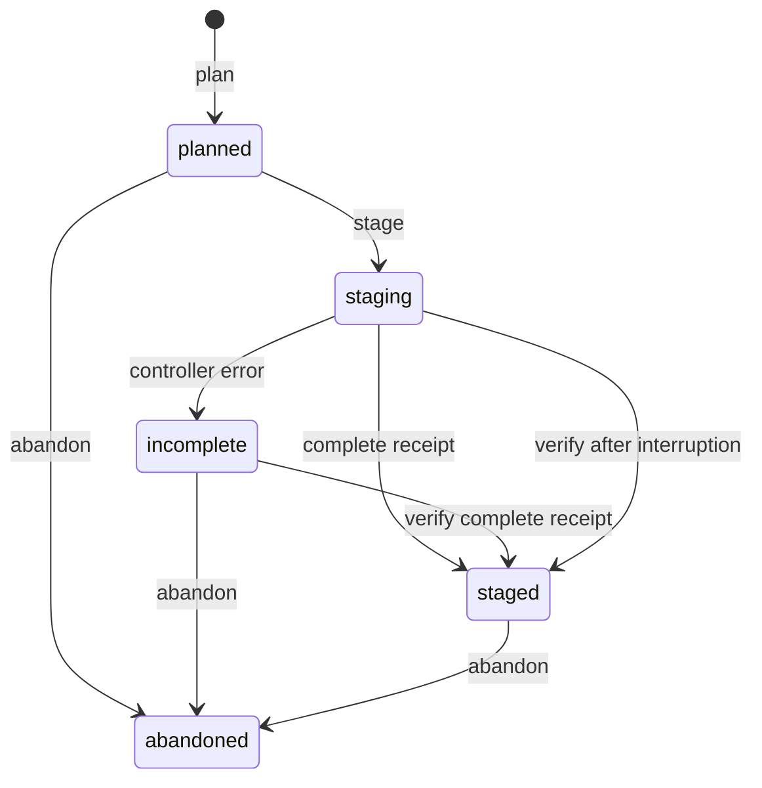

# Подготовка ресурсного сброса владельцем

`omk admin resource-resets` связывает проверенную остановку, завершённую копию
и **отдельный пустой Linux volume**. Команды `plan`, `stage`, `verify`, `status`,
`list`, `abandon` доступны только в локальной утилите владельца. Источник и backup
монтируются read-only. Серверный endpoint не переключается; кандидат получает
`ready_for_start=false`.

Это подготовка данных для будущего сброса, не рабочая команда вайпа. До запуска
кандидата остаются нативная повторная проверка высадки, online-эвакуация/закрытие
переходов, остальные transport adapters и проверенный cutover/recovery.

## Настройка

Нужны приватные [operator/maintenance](OWNER_MAINTENANCE.md) и
[backup](COLD_BACKUPS.md) настройки. Скопируйте
[`deploy/resource-resets.example.toml`](../deploy/resource-resets.example.toml)
в `.omk-admin/resource-resets.toml`, mode 600:

```toml
schema = 1
[servers.dj2]
data_volume = "omk-dj2-resource-candidate-NEW_OPERATION"
owner = "REPLACE_WITH_FRESH_CANDIDATE_ID"
label = "omkality.server.id"
image = "eclipse-temurin:8-jre@sha256:377fe8e36a4b1530d9d52020069367ef44313fa891a82ae102b1016a6a3a72f5"
release = "dj2-2.23.4-candidate"
dimension = -18000
```

Volume создаётся владельцем отдельно, с указанным ownership label. Утилита
проверяет его наличие, имя, `CreatedAt` и label перед каждым helper; отсутствующий
том не создаётся автоматически. Кандидат должен быть пустым и не фигурировать
**ни в одном** running/stopped контейнере или helper.

Image/release должны совпадать с source в `backups.toml`. Имена volumes всех
source/store/restore/reset targets проверяются общим реестром: совпадение
блокирует оба сценария. Диагностический сервер без backup target не требует
искусственной конфигурации копирования.

ID задаётся в приватном конфиге и `plan --dimension`. Он должен совпасть с
проверенной resource policy, JED и сохранённой identity. Overworld, Nether,
известные сюжетные ID и другой ненастроенный ID отклоняются. Расширение на
остальные миры этим шагом не включается.

## Порядок действий

`M`, `B`, `R` — идентификаторы из JSON соответствующей предыдущей команды.

```console
uv run omk admin --config .omk-admin/operator.toml maintenance plan --server dj2
uv run omk admin --config .omk-admin/operator.toml maintenance stop --operation M
uv run omk admin --config .omk-admin/operator.toml backups plan --server dj2
uv run omk admin --config .omk-admin/operator.toml backups run --operation B
uv run omk admin --config .omk-admin/operator.toml resource-resets inspect --server dj2 --dimension -18000 --preflight
uv run omk admin --config .omk-admin/operator.toml resource-resets plan --server dj2 --dimension -18000 --maintenance-operation M --backup-operation B
uv run omk admin --config .omk-admin/operator.toml resource-resets stage --operation R
uv run omk admin --config .omk-admin/operator.toml resource-resets verify --operation R
```

`plan` замораживает stop window, completed backup, source/runtime identities,
destination identity, бюджет и preflight. Source inventory должен совпасть
с последней проверенной копией. Высадка выбирается только через auto preflight;
ручного обхода неизвестных ссылок в owner CLI нет.

`stage` записывает durable intent до первой записи кандидата. В target копируются
сохраняемые файлы; старая ресурсная DIM и её marker исключаются. Рассмотренные
FTB homes/claims/warps/back/death, позиции игроков и известные предметные ссылки
обрабатывает [существующий data adapter](RESOURCE_RESET_STAGING.md). Перечень
разрешённых порталов/serializers не расширяется.

`verify` заново читает архив, источник, замороженный план, receipt и **каждый**
файл кандидата. `staged` означает готовность копии данных к следующему этапу
проверки, а не разрешение запуска.

## Барьер и восстановление после прерывания

Любая операция, кроме `abandoned`, блокирует `maintenance start` и
`maintenance cancel` связанного окна. Общая блокировка `backups.lock`
сериализует owner-команды. Некорректный журнал также блокирует возврат,
без вывода его содержимого в ошибку.



После потери ответа не повторяйте `stage`:

```console
uv run omk admin --config .omk-admin/operator.toml resource-resets list --server dj2
uv run omk admin --config .omk-admin/operator.toml resource-resets status --operation R
uv run omk admin --config .omk-admin/operator.toml resource-resets verify --operation R
```

Если helper успел завершить копирование, readonly `verify` подтверждает receipt
без повторного извлечения. Частичная копия не принимается и остаётся для
разбирательства. Работающий или ещё существующий helper блокирует проверку и
освобождение окна. Автоматического удаления/force kill writer нет.

Пока cutover не реализован, для возврата **исходного** сервера нужно явно
отказаться от переключения на кандидата:

```console
uv run omk admin --config .omk-admin/operator.toml resource-resets abandon --operation R
uv run omk admin --config .omk-admin/operator.toml maintenance start --operation M --backup-operation B
```

`abandon` сохраняет файлы target и освобождает барьер только при прежнем чистом
source checkpoint и свободном target. Операция идемпотентна. Непустой оставленный
target не принимается для нового stage: нужен новый явно настроенный пустой
volume. Старые копии владелец разбирает отдельно; автоматического garbage
collection нет. Контроль не блокирует сторонний Docker CLI и ручные правки.

## Журналы и пределы

Журналы лежат рядом с operator config:
**`.omk-admin/resource-resets/<operation>.json`**, mode 600. Общий аудит —
`.omk-admin/audit.jsonl`. `status/list` показывают сводку без raw NBT, пароля RCON,
токенов и содержимого runtime-конфигураций.

Используются `OMK_BACKUP_*`: staging/reserve/world budgets, CPU/RAM/helper
timeout, plan TTL и число журналов. Перед `stage` политика должна совпасть с
планом и completed backup; лимиты проверяются до записи. `verify` использует
замороженную политику для восстановления intent. Это пределы операции;
общий VPS budget/off-host storage остаётся в #33.

`OMK_RESET_LANDING_RADIUS`, `OMK_RESET_LANDING_VERTICAL`,
`OMK_RESET_LANDING_CHUNK_BUDGET`, `OMK_RESET_REFERENCE_CHUNK_BUDGET` передаются
в Linux helper и входят в frozen preflight. Диапазоны — в
[описании preflight](RESOURCE_RESET_PREFLIGHT.md). Неизвестные ссылки и
отсутствие рассмотренной высадки блокируют подготовку.

Версия и SHA preflight сверяются с текущим data profile, включая повторное
чтение после worker. Изменение профиля во время проверки приводит к отказу;
новая версия профиля не требует правки номера в Python-валидаторе.

## Приёмка 11 ноября 2026

Полная DJ2 2.23.4 / Core 0.3.5 / DJ2Fix 0.1.4, Linux Docker: **30 native и
70 независимых условий**. Два Drasl-аккаунта, два clean старта исходного
контейнера и один настоящий cold backup. Подготовлены два отдельных кандидата:
обычный путь и потеря ответа контроллера после завершения worker с последующим
readonly `verify`, без повторного извлечения.

Исходные 320 файлов при обеих подготовках побайтно прежние. Каждый кандидат
содержит 302 world-файла: 4 изменены, 18 старых ресурсных файлов исключены.
Удалены ресурсный home и 197 ресурсных claims; home второго игрока, 1444 claims
остальных миров, команды/права FTB, типизированные Inventory/XP/UUID сохранены.
Один игрок из ресурса перенесён в замороженную точку основного мира. Проверены
CRC/SHA и каждый байт фактического backup ZIP.

Барьер start/cancel держался до явного `abandon`. После отказа от обоих
кандидатов исходный контейнер запущен с прежним ресурсным миром, измерениями
игроков, вещами и опытом. Кандидаты не запускались. После экспорта удалены
только собственные game/auth/store/candidate Docker scopes.

Один ранний fixture-прогон исключён: Underground Biomes заменил каменный пол
высадки модовым камнем, которого нет в консервативном allowlist. Фикстура
переведена на железные блоки; allowlist не ослаблен. Отдельно воспроизведён и
исправлен отказ inspection из-за устаревшего v1 при текущем preflight v3.
Регрессионный тест падал до исправления и проходит после него.

44 новых synthetic случая; Windows: 1425 unit + 55 UI, 12 skipped; Linux
focused: 282. Это не графическая игровая приёмка, не wipe любого измерения и
не разрешение cutover. Готовность новой копии, эвакуация online-игроков и
полный restart с модовыми ссылками остаются в #32; VPS пока не нужен.
[Обезличенный протокол](validation/dj2-owner-resource-staging-2026-11-11.json).
